# Project_template

Это шаблон для решения проектной работы. Структура этого файла повторяет структуру заданий. Заполняйте его по мере работы над решением.

# Задание 1. Анализ и планирование

### 1. Описание функциональности монолитного приложения

**Управление отоплением:**

- Пользователи могут удалённо включать и выключать отопление через **REST API** монолита: состояние и параметры задаются для зарегистрированных датчиков (поля `value` и `status` через `PATCH /api/v1/sensors/:id/value`). Отдельного веб-интерфейса в текущем решении нет.
- Система поддерживает учёт модулей в виде записей **Sensor** в таблице `sensors`: создание, просмотр, изменение и удаление (`/api/v1/sensors`). Температура и состояние отопления хранятся на одной записи в полях `value` и `status`, а не в отдельных сущностях.
- Подключение нового дома к системе выполняется не пользователем, а специалистом при выезде; самостоятельная регистрация устройств в продукте не предусмотрена. По кейсу к системе подключено около 100 модулей и столько же клиентов, работающих с API (в репозитории — только серверная часть API).

**Мониторинг температуры:**

- Пользователи могут просматривать текущую температуру по дому через **REST API**: список датчиков и отдельный датчик (`GET /api/v1/sensors`, `GET /api/v1/sensors/:id`), а также запрос по помещению (`GET /api/v1/sensors/temperature/:location`).
- Система поддерживает хранение метаданных датчиков (имя, тип, локация, единицы измерения) в PostgreSQL и при чтении подмешивает актуальные показания температуры, запрашивая их у внешнего HTTP-сервиса датчиков (`TemperatureService` → `temperature-api`). Опрос выполняется синхронно в рамках обработки REST-запроса.

### 2. Анализ архитектуры монолитного приложения

- **Язык и runtime:** Go; HTTP-сервер на фреймворке Gin.
- **База данных:** PostgreSQL; доступ через пул соединений `pgx`. Основная сущность — таблица `sensors` (метаданные и последние сохранённые значения).
- **Архитектурный стиль:** монолит — обработка HTTP, бизнес-логика и доступ к данным находятся в одном приложении (`handlers` → `services` → `db`), один процесс деплоя (`Dockerfile`). Сценарии «реестр датчиков», «мониторинг температуры» и «управление отоплением» реализованы в одном REST API, без отдельных bounded context в коде.
- **Взаимодействие:** синхронное, без очередей и событий. Клиенты обращаются к REST API монолита; монолит синхронно вызывает внешний сервис температуры и обращается к БД в том же потоке запроса.
- **Интеграция с устройствами:** `temperature-api` — HTTP-канал монолита к показаниям полевых модулей в текущем деплое (`TemperatureService` → `TEMPERATURE_API_URL`); отдельного клиента «к железу» в коде монолита нет. Изменение отопления (`value`, `status`) — запись в PostgreSQL, без вызова поля (в том числе без HTTP к `temperature-api`).
- **Масштабируемость:** ограничена — масштабировать можно только экземпляр монолита целиком, состояние сосредоточено в одной БД; рост числа домов увеличивает нагрузку на синхронные опросы.
- **Развёртывание:** обновление версии требует перезапуска всего приложения; отдельные домены (отопление, телеметрия) нельзя выкатывать независимо.

### 3. Определение доменов и границы контекстов

Ниже — bounded context **текущего** решения (As-Is): только то, что реально выполняется монолитом и сопутствующим процессом эксплуатации по кейсу.

#### 3.1. Датчики / модули (bounded context монолита)

**Граница контекста:** учёт модулей и сценарии владельца дома (просмотр температуры, изменение отопления). Реализация — один Go-процесс: `SensorHandler` (`handlers`), клиент `TemperatureService` (`services`), PostgreSQL (`db`).

**Акторы:** владелец дома (внешний **клиент REST API**, UI в репозитории не поставляется), косвенно — специалист при регистрации модуля через тот же API (см. п. 3.2).

**Модель данных (As-Is):** одна сущность **`Sensor`** (таблица `sensors`) — `name`, `type`, `location`, `unit`, **`value`**, **`status`**, метки времени. Отдельных сущностей «показание температуры» или «режим отопления» нет: температура и статус всегда на **одной строке**.

- **`PATCH /api/v1/sensors/:id/value`** — пишет в БД пару **`value` + `status`** на этой строке (управление отоплением через API).
- **`GET /api/v1/sensors`**, **`GET /api/v1/sensors/:id`** — читают ту же строку; при `sensor.Type == temperature` handler подменяет в **JSON-ответе** `value`, `status`, `last_updated` данными из `temperature-api` (в БД при GET не обновляет).
- Колонка **`type`** — строковый классификатор; в коде задана константа `temperature`, она только **включает** опрос `temperature-api` на чтении, а не описывает второй домен или сущность.

Реестр, мониторинг и управление — **разные HTTP-сценарии над одним `Sensor`**. Блоки операций ниже — группировка вызовов, не отдельные домены.

**Реестр и метаданные устройств**

- Создать запись о датчике/модуле — `POST /api/v1/sensors`.
- Получить список устройств — `GET /api/v1/sensors`.
- Получить карточку по идентификатору — `GET /api/v1/sensors/:id`.
- Изменить метаданные — `PUT /api/v1/sensors/:id`.
- Удалить из реестра — `DELETE /api/v1/sensors/:id`.
- Персистентность — SQL CRUD по таблице `sensors`.

**Мониторинг температуры**

- Температура по помещению — `GET /api/v1/sensors/temperature/:location`.
- Подмешать телеметрию в список/карточку — `TemperatureService` внутри `GET /api/v1/sensors` и `GET /api/v1/sensors/:id` (ветка `Type == temperature`): в ответ подставляются `value`, `status`, `last_updated` с `temperature-api`.
- Опрос телеметрии поля — синхронный HTTP к `temperature-api` (в As-Is это единственный способ получить показания модулей из монолита).
- Отдельного хранилища временных рядов нет — «текущая температура» это те же поля `value`/`status` на `Sensor`, временно подменённые в ответе GET.

**Управление отоплением**

- Задать уставку и состояние — `PATCH /api/v1/sensors/:id/value` (запись в PostgreSQL, без вызова полевого модуля из монолита).
- Прочитать параметры через API — те же `GET`, что и для мониторинга; при `Type == temperature` сохранённые в БД `value`/`status` в ответе могут быть заменены телеметрией с `temperature-api`.

#### 3.2. Подключение и провизионинг (процесс на границе системы)

**Граница контекста:** вывод нового дома на обслуживание. В монолите **нет** отдельного модуля провизионинга — это процесс компании (монтажник на объекте) с минимальным касанием приложения.

**Операции:**

- Монтаж и первичная настройка модуля — выполняет монтажник, вне HTTP API монолита (работа с полевым оборудованием).
- Внесение модуля в учёт системы — `POST /api/v1/sensors` (тот же контракт, что в реестре п. 3.1; отдельного сценария для владельца дома в приложении нет).

### **4. Проблемы монолитного решения**

- Нет самообслуживания при подключении датчиков — масштабирование на умные посёлки упирается в выезд специалистов.
- Функциональность ограничена отоплением и температурой; добавление света, ворот, видеонаблюдения и устройств партнёров потребует существенных изменений монолита.
- Тесная связность слоёв и единая БД усложняют поэтапный вынос микросервисов и независимые релизы.
- Синхронный опрос датчиков на каждый запрос списка/карточки датчика создаёт риск задержек и каскадных отказов при росте числа домов.
- Поля `value` и `status` одновременно несут смысл управления отоплением и показаний с `temperature-api` на `GET` — следствие слияния сценариев в одном bounded context без разделения модели.
- Нельзя отдельно масштабировать только телеметрию или только управление.
- Нет унифицированной модели устройств и протоколов для экосистемы партнёров, что противоречит целевой SaaS-экосистеме.
- Bounded contexts не выражены в коде и инфраструктуре, что затрудняет переход к As-Is/To-Be плану и MVP с микросервисами.

### 5. Визуализация контекста системы — диаграмма С4

#### Context diagram

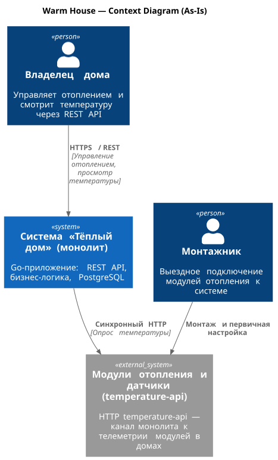

#### Container diagram

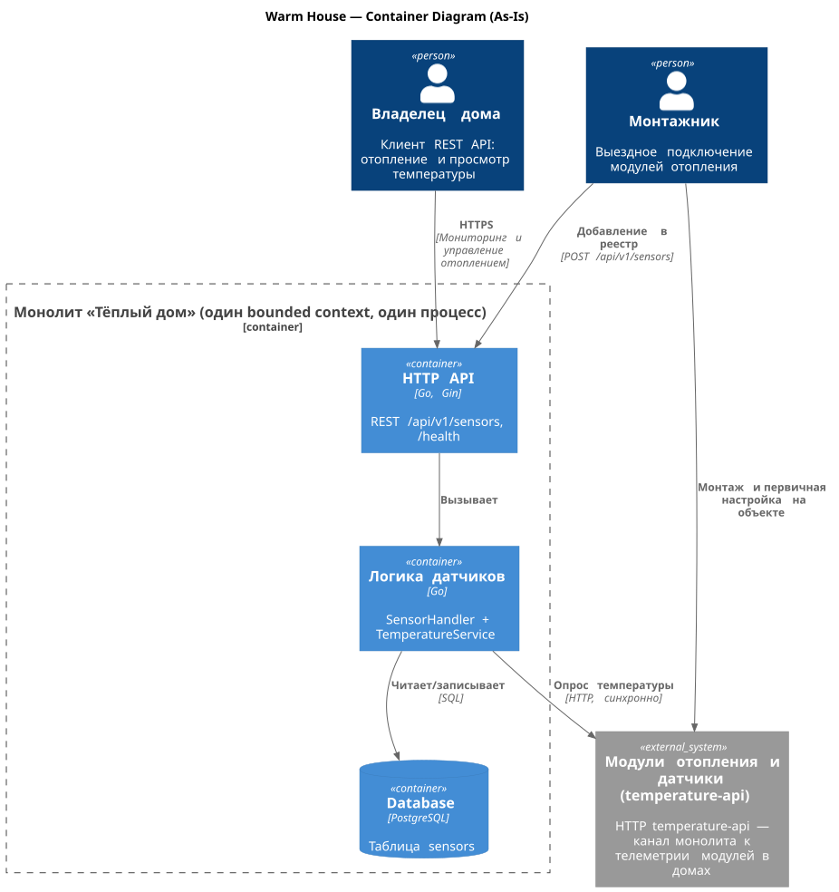

# Задание 2. Проектирование микросервисной архитектуры

В этом задании вам нужно предоставить только диаграммы в модели C4. Мы не просим вас отдельно описывать получившиеся микросервисы и то, как вы определили взаимодействия между компонентами To-Be системы. Если вы правильно подготовите диаграммы C4, они и так это покажут.

**Контекст (To-Be, опционально для обзора)**

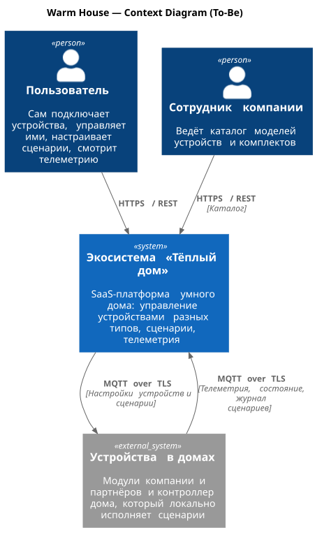

**Диаграмма контейнеров (Containers)**

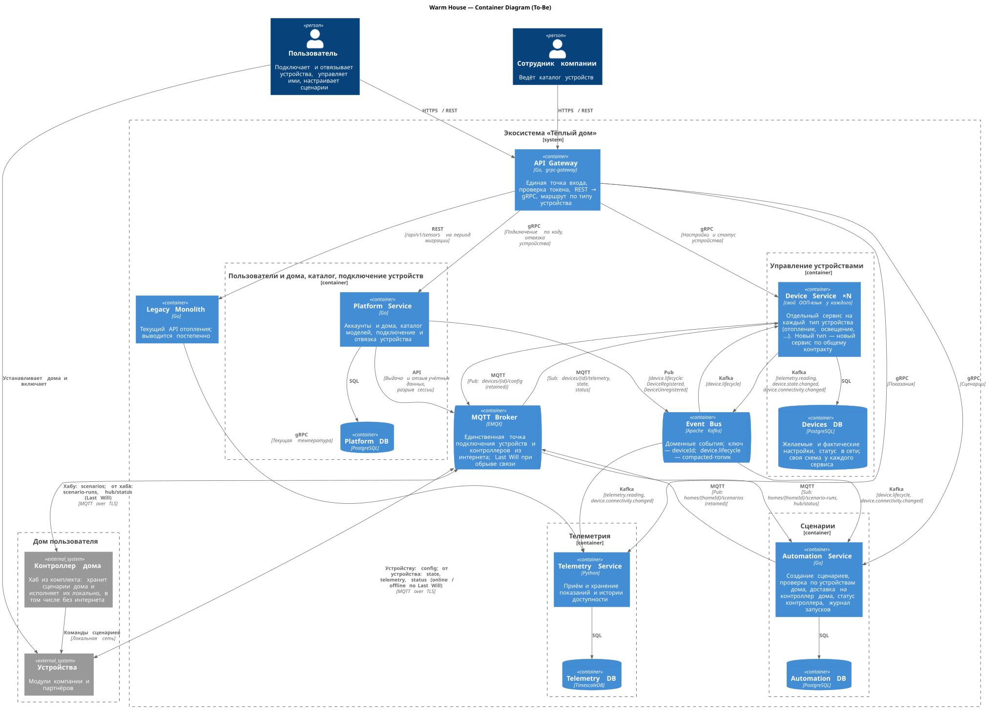

**Диаграмма компонентов (Components)**

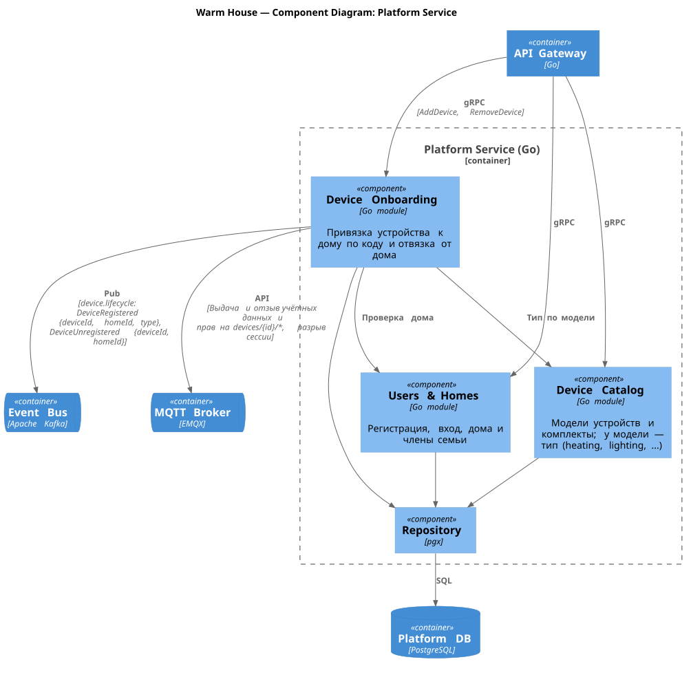

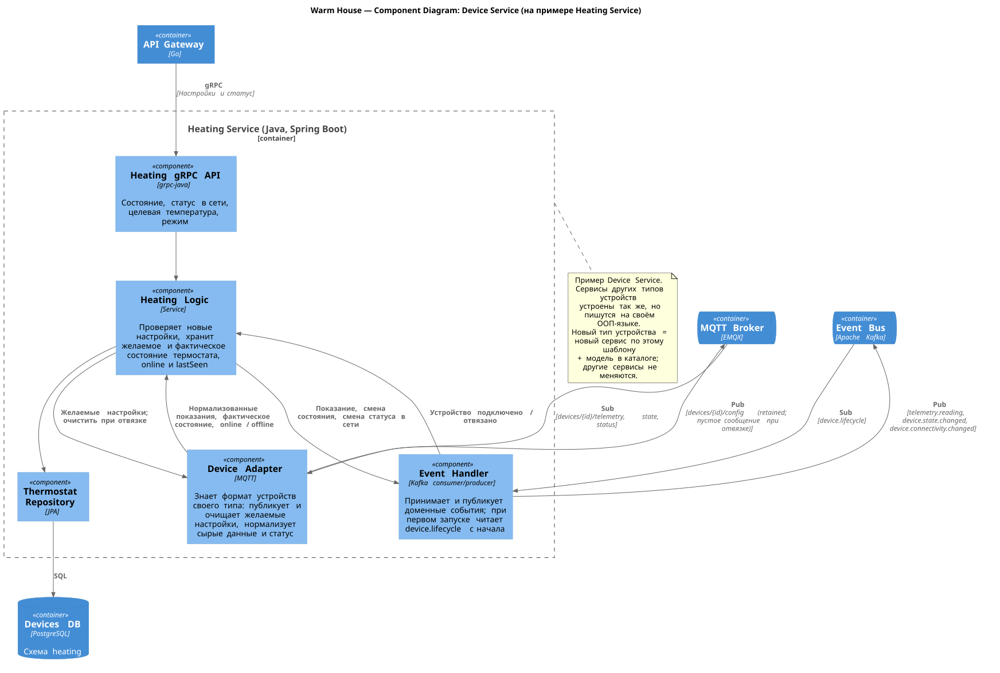

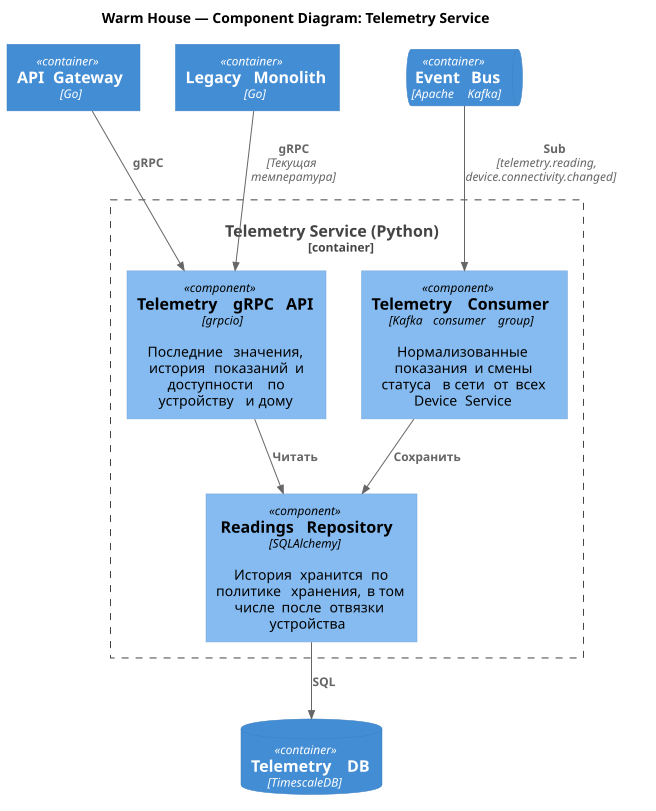

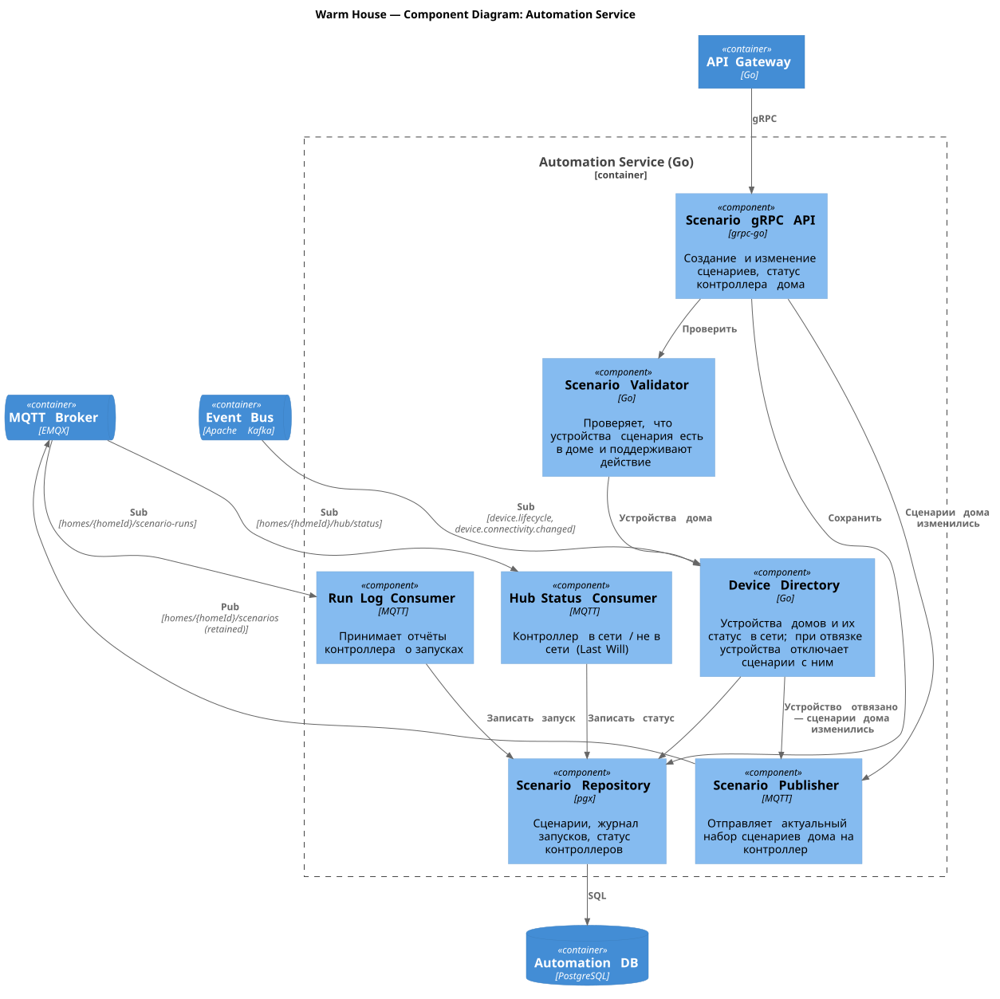

**Диаграмма кода (Code)**

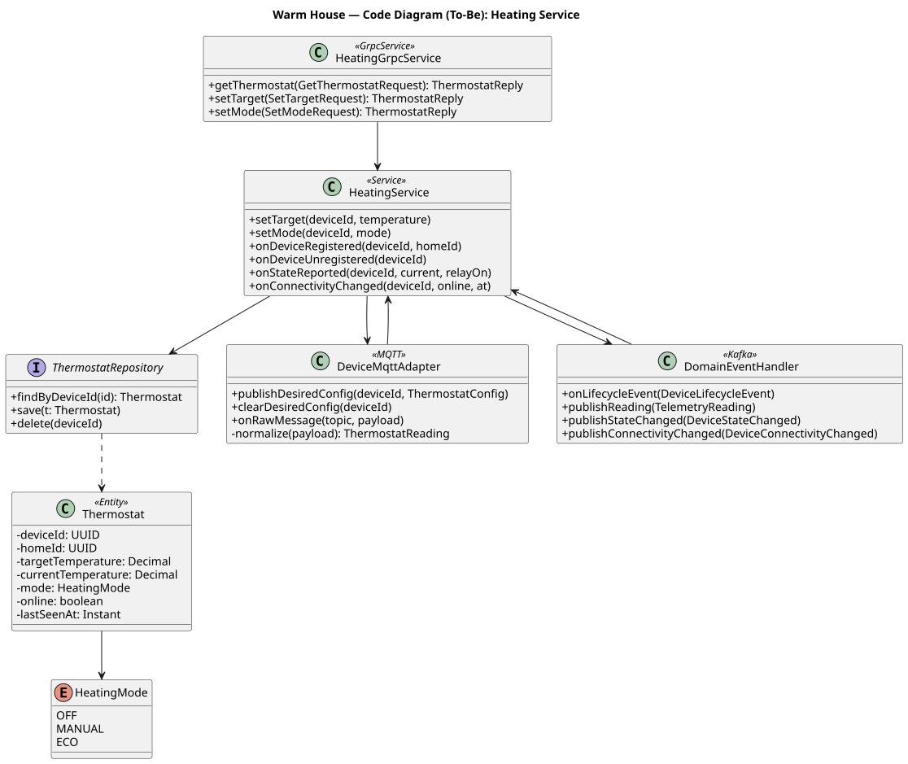

**Динамические диаграммы (Dynamic)**

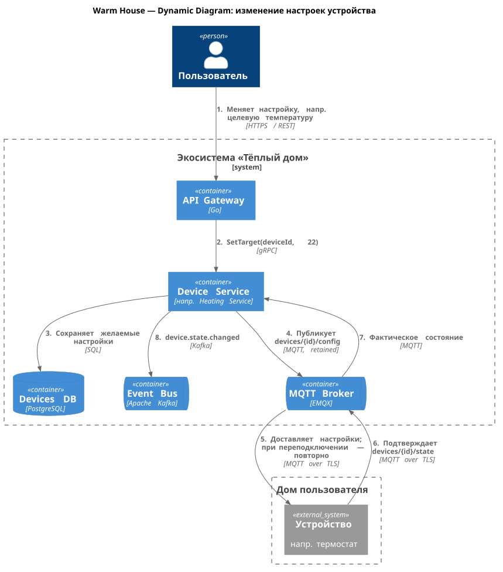

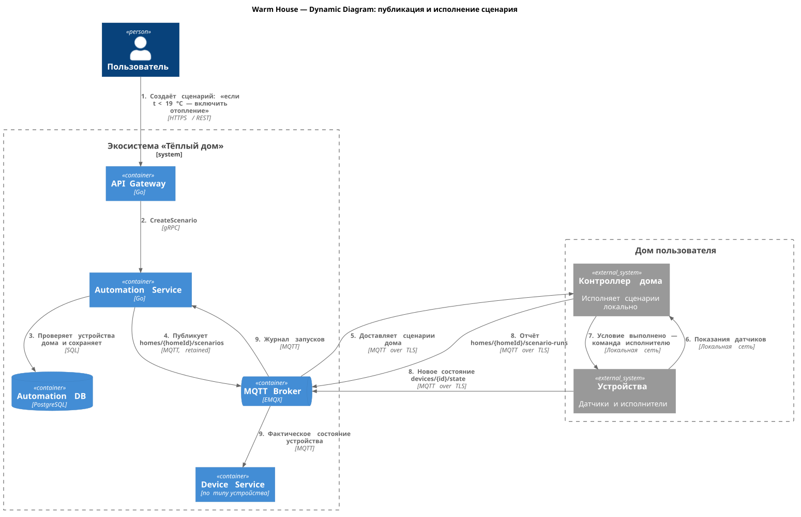

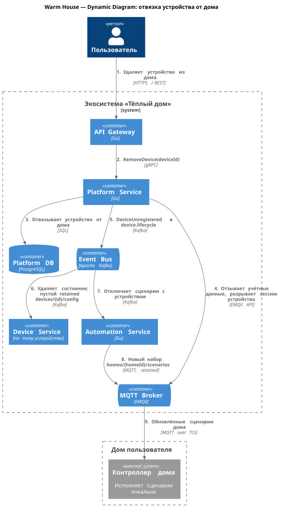

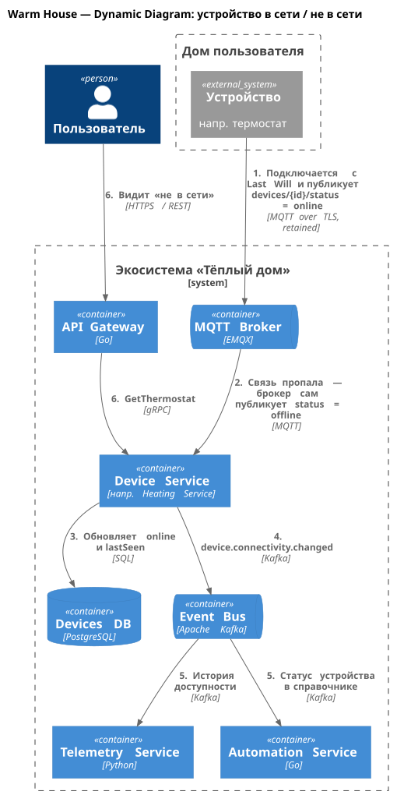

# Задание 3. Разработка ER-диаграммы

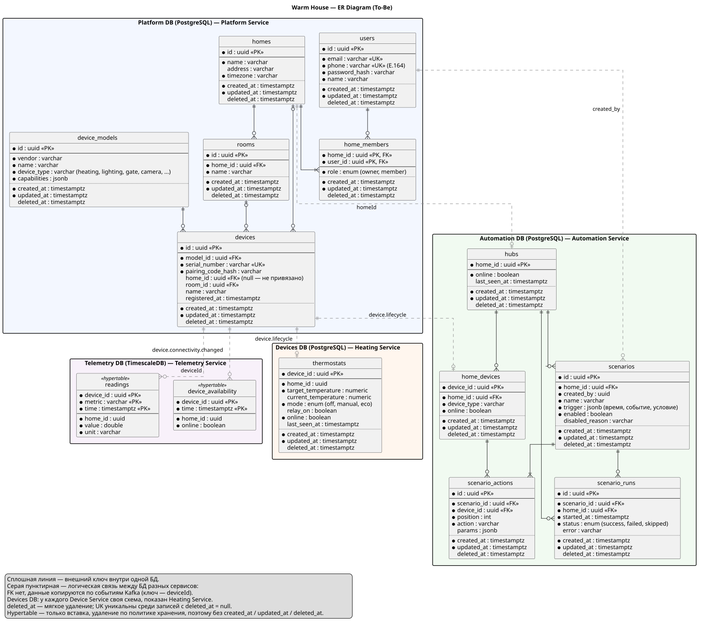

- **База данных на сервис:** сущности сгруппированы по БД из диаграммы контейнеров. Внешние ключи есть только внутри одной БД.
- **Связи между сервисами** логические (серый пунктир): Device Service и Automation Service хранят свою копию `deviceId` и `homeId`, которую получают из `device.lifecycle`; Telemetry Service пишет историю по `telemetry.reading` и `device.connectivity.changed`.
- **Устройство** (`devices`) — экземпляр модели из каталога (`device_models`). `home_id = null` означает, что устройство отвязано; при повторной привязке запись переиспользуется.
- **Тип устройства** задаётся моделью (`device_type`) и определяет, какой Device Service отвечает за устройство. Для каждого типа — своя схема в Devices DB, на диаграмме показана схема Heating Service (`thermostats`).
- **Сценарий** принадлежит дому и исполняется его контроллером (`hubs`, один на дом). Действия сценария ссылаются только на устройства этого дома (`home_devices`). При отвязке устройства сценарий отключается (`enabled = false`, `disabled_reason`).
- **Телеметрия** хранится в hypertable TimescaleDB и остаётся после отвязки устройства, пока не истечёт срок хранения.
- **Служебные поля:** во всех таблицах PostgreSQL есть `created_at`, `updated_at`, `deleted_at`. Удаление мягкое (`deleted_at` заполняется), уникальные ключи (`email`, `phone`, `serial_number`) уникальны только среди неудалённых записей — частичный индекс `WHERE deleted_at IS NULL`. Hypertable телеметрии только дописываются и чистятся политикой хранения, поэтому служебных полей в них нет.

# Задание 4. Создание и документирование API

### 1. Тип API

Укажите, какой тип API вы будете использовать для взаимодействия микросервисов. Объясните своё решение.

### 2. Документация API

Здесь приложите ссылки на документацию API для микросервисов, которые вы спроектировали в первой части проектной работы. Для документирования используйте Swagger/OpenAPI или AsyncAPI.

# Задание 5. Работа с docker и docker-compose

Перейдите в apps.

Там находится приложение-монолит для работы с датчиками температуры. В README.md описано как запустить решение.

Вам нужно:

1) сделать простое приложение temperature-api на любом удобном для вас языке программирования, которое при запросе /temperature?location= будет отдавать рандомное значение температуры.

Locations - название комнаты, sensorId - идентификатор названия комнаты

```
	// If no location is provided, use a default based on sensor ID
	if location == "" {
		switch sensorID {
		case "1":
			location = "Living Room"
		case "2":
			location = "Bedroom"
		case "3":
			location = "Kitchen"
		default:
			location = "Unknown"
		}
	}

	// If no sensor ID is provided, generate one based on location
	if sensorID == "" {
		switch location {
		case "Living Room":
			sensorID = "1"
		case "Bedroom":
			sensorID = "2"
		case "Kitchen":
			sensorID = "3"
		default:
			sensorID = "0"
		}
	}
```

2) Приложение следует упаковать в Docker и добавить в docker-compose. Порт по умолчанию должен быть 8081

3) Кроме того для smart_home приложения требуется база данных - добавьте в docker-compose файл настройки для запуска postgres с указанием скрипта инициализации ./smart_home/init.sql

Для проверки можно использовать Postman коллекцию smarthome-api.postman_collection.json и вызвать:

- Create Sensor
- Get All Sensors

Должно при каждом вызове отображаться разное значение температуры

Ревьюер будет проверять точно так же.


# **Задание 6. Разработка MVP**

Необходимо создать новые микросервисы и обеспечить их интеграции с существующим монолитом для плавного перехода к микросервисной архитектуре. 

### **Что нужно сделать**

1. Создайте новые микросервисы для управления телеметрией и устройствами (с простейшей логикой), которые будут интегрированы с существующим монолитным приложением. Каждый микросервис на своем ООП языке.
2. Обеспечьте взаимодействие между микросервисами и монолитом (при желании с помощью брокера сообщений), чтобы постепенно перенести функциональность из монолита в микросервисы. 

В результате у вас должны быть созданы Dockerfiles и docker-compose для запуска микросервисов. 