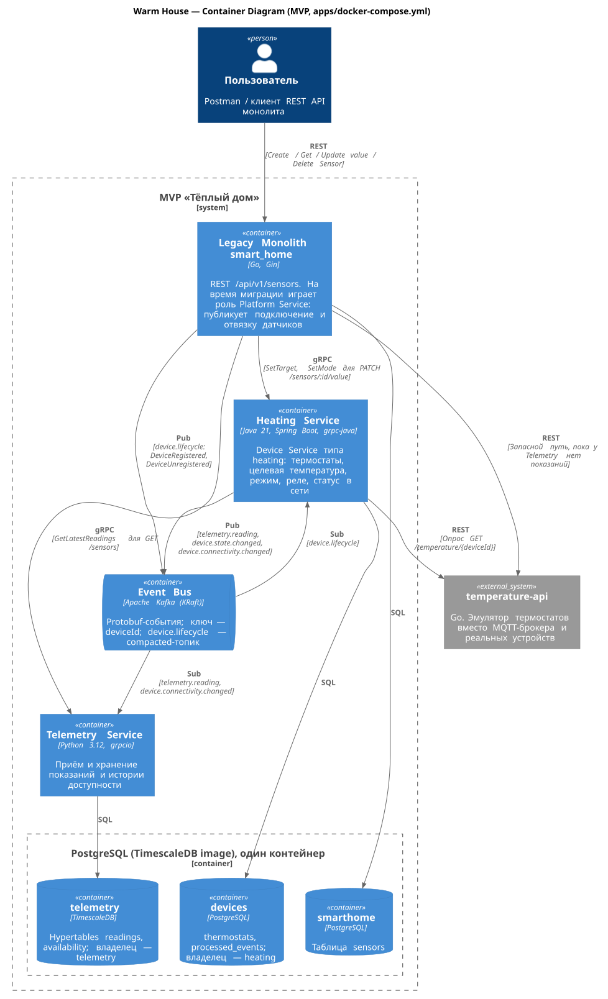

# Project_template

Это шаблон для решения проектной работы. Структура этого файла повторяет структуру заданий. Заполняйте его по мере работы над решением.

# Задание 1. Анализ и планирование

### 1. Описание функциональности монолитного приложения

**Управление отоплением:**

- Пользователи могут удалённо включать и выключать отопление через **REST API** монолита: состояние и параметры задаются для зарегистрированных датчиков (поля `value` и `status` через `PATCH /api/v1/sensors/:id/value`). Отдельного веб-интерфейса в текущем решении нет.
- Система поддерживает учёт модулей в виде записей **Sensor** в таблице `sensors`: создание, просмотр, изменение и удаление (`/api/v1/sensors`). Температура и состояние отопления хранятся на одной записи в полях `value` и `status`, а не в отдельных сущностях.
- Подключение нового дома к системе выполняется не пользователем, а специалистом при выезде; самостоятельная регистрация устройств в продукте не предусмотрена. По кейсу к системе подключено около 100 модулей и столько же клиентов, работающих с API (в репозитории — только серверная часть API).

**Мониторинг температуры:**

- Пользователи могут просматривать текущую температуру по дому через **REST API**: список датчиков и отдельный датчик (`GET /api/v1/sensors`, `GET /api/v1/sensors/:id`), а также запрос по помещению (`GET /api/v1/sensors/temperature/:location`).
- Система поддерживает хранение метаданных датчиков (имя, тип, локация, единицы измерения) в PostgreSQL и при чтении подмешивает актуальные показания температуры, запрашивая их у внешнего HTTP-сервиса датчиков (`TemperatureService` → `temperature-api`). Опрос выполняется синхронно в рамках обработки REST-запроса.

### 2. Анализ архитектуры монолитного приложения

- **Язык и runtime:** Go; HTTP-сервер на фреймворке Gin.
- **База данных:** PostgreSQL; доступ через пул соединений `pgx`. Основная сущность — таблица `sensors` (метаданные и последние сохранённые значения).
- **Архитектурный стиль:** монолит — обработка HTTP, бизнес-логика и доступ к данным находятся в одном приложении (`handlers` → `services` → `db`), один процесс деплоя (`Dockerfile`). Сценарии «реестр датчиков», «мониторинг температуры» и «управление отоплением» реализованы в одном REST API, без отдельных bounded context в коде.
- **Взаимодействие:** синхронное, без очередей и событий. Клиенты обращаются к REST API монолита; монолит синхронно вызывает внешний сервис температуры и обращается к БД в том же потоке запроса.
- **Интеграция с устройствами:** `temperature-api` — HTTP-канал монолита к показаниям полевых модулей в текущем деплое (`TemperatureService` → `TEMPERATURE_API_URL`); отдельного клиента «к железу» в коде монолита нет. Изменение отопления (`value`, `status`) — запись в PostgreSQL, без вызова поля (в том числе без HTTP к `temperature-api`).
- **Масштабируемость:** ограничена — масштабировать можно только экземпляр монолита целиком, состояние сосредоточено в одной БД; рост числа домов увеличивает нагрузку на синхронные опросы.
- **Развёртывание:** обновление версии требует перезапуска всего приложения; отдельные домены (отопление, телеметрия) нельзя выкатывать независимо.

### 3. Определение доменов и границы контекстов

Ниже — bounded context **текущего** решения (As-Is): только то, что реально выполняется монолитом и сопутствующим процессом эксплуатации по кейсу.

#### 3.1. Датчики / модули (bounded context монолита)

**Граница контекста:** учёт модулей и сценарии владельца дома (просмотр температуры, изменение отопления). Реализация — один Go-процесс: `SensorHandler` (`handlers`), клиент `TemperatureService` (`services`), PostgreSQL (`db`).

**Акторы:** владелец дома (внешний **клиент REST API**, UI в репозитории не поставляется), косвенно — специалист при регистрации модуля через тот же API (см. п. 3.2).

**Модель данных (As-Is):** одна сущность **`Sensor`** (таблица `sensors`) — `name`, `type`, `location`, `unit`, **`value`**, **`status`**, метки времени. Отдельных сущностей «показание температуры» или «режим отопления» нет: температура и статус всегда на **одной строке**.

- **`PATCH /api/v1/sensors/:id/value`** — пишет в БД пару **`value` + `status`** на этой строке (управление отоплением через API).
- **`GET /api/v1/sensors`**, **`GET /api/v1/sensors/:id`** — читают ту же строку; при `sensor.Type == temperature` handler подменяет в **JSON-ответе** `value`, `status`, `last_updated` данными из `temperature-api` (в БД при GET не обновляет).
- Колонка **`type`** — строковый классификатор; в коде задана константа `temperature`, она только **включает** опрос `temperature-api` на чтении, а не описывает второй домен или сущность.

Реестр, мониторинг и управление — **разные HTTP-сценарии над одним `Sensor`**. Блоки операций ниже — группировка вызовов, не отдельные домены.

**Реестр и метаданные устройств**

- Создать запись о датчике/модуле — `POST /api/v1/sensors`.
- Получить список устройств — `GET /api/v1/sensors`.
- Получить карточку по идентификатору — `GET /api/v1/sensors/:id`.
- Изменить метаданные — `PUT /api/v1/sensors/:id`.
- Удалить из реестра — `DELETE /api/v1/sensors/:id`.
- Персистентность — SQL CRUD по таблице `sensors`.

**Мониторинг температуры**

- Температура по помещению — `GET /api/v1/sensors/temperature/:location`.
- Подмешать телеметрию в список/карточку — `TemperatureService` внутри `GET /api/v1/sensors` и `GET /api/v1/sensors/:id` (ветка `Type == temperature`): в ответ подставляются `value`, `status`, `last_updated` с `temperature-api`.
- Опрос телеметрии поля — синхронный HTTP к `temperature-api` (в As-Is это единственный способ получить показания модулей из монолита).
- Отдельного хранилища временных рядов нет — «текущая температура» это те же поля `value`/`status` на `Sensor`, временно подменённые в ответе GET.

**Управление отоплением**

- Задать уставку и состояние — `PATCH /api/v1/sensors/:id/value` (запись в PostgreSQL, без вызова полевого модуля из монолита).
- Прочитать параметры через API — те же `GET`, что и для мониторинга; при `Type == temperature` сохранённые в БД `value`/`status` в ответе могут быть заменены телеметрией с `temperature-api`.

#### 3.2. Подключение и провизионинг (процесс на границе системы)

**Граница контекста:** вывод нового дома на обслуживание. В монолите **нет** отдельного модуля провизионинга — это процесс компании (монтажник на объекте) с минимальным касанием приложения.

**Операции:**

- Монтаж и первичная настройка модуля — выполняет монтажник, вне HTTP API монолита (работа с полевым оборудованием).
- Внесение модуля в учёт системы — `POST /api/v1/sensors` (тот же контракт, что в реестре п. 3.1; отдельного сценария для владельца дома в приложении нет).

### **4. Проблемы монолитного решения**

- Нет самообслуживания при подключении датчиков — масштабирование на умные посёлки упирается в выезд специалистов.
- Функциональность ограничена отоплением и температурой; добавление света, ворот, видеонаблюдения и устройств партнёров потребует существенных изменений монолита.
- Тесная связность слоёв и единая БД усложняют поэтапный вынос микросервисов и независимые релизы.
- Синхронный опрос датчиков на каждый запрос списка/карточки датчика создаёт риск задержек и каскадных отказов при росте числа домов.
- Поля `value` и `status` одновременно несут смысл управления отоплением и показаний с `temperature-api` на `GET` — следствие слияния сценариев в одном bounded context без разделения модели.
- Нельзя отдельно масштабировать только телеметрию или только управление.
- Нет унифицированной модели устройств и протоколов для экосистемы партнёров, что противоречит целевой SaaS-экосистеме.
- Bounded contexts не выражены в коде и инфраструктуре, что затрудняет переход к As-Is/To-Be плану и MVP с микросервисами.

### 5. Визуализация контекста системы — диаграмма С4

#### Context diagram


#### Container diagram


# Задание 2. Проектирование микросервисной архитектуры

В этом задании вам нужно предоставить только диаграммы в модели C4. Мы не просим вас отдельно описывать получившиеся микросервисы и то, как вы определили взаимодействия между компонентами To-Be системы. Если вы правильно подготовите диаграммы C4, они и так это покажут.

**Контекст (To-Be, опционально для обзора)**


**Диаграмма контейнеров (Containers)**


**Диаграмма компонентов (Components)**


**Диаграмма кода (Code)**


**Динамические диаграммы (Dynamic)**


# Задание 3. Разработка ER-диаграммы


- **База данных на сервис:** сущности сгруппированы по БД из диаграммы контейнеров. Внешние ключи есть только внутри одной БД.
- **Связи между сервисами** логические (серый пунктир): Device Service и Automation Service хранят свою копию `deviceId` и `homeId`, которую получают из `device.lifecycle`; Telemetry Service пишет историю по `telemetry.reading` и `device.connectivity.changed`.
- **Устройство** (`devices`) — экземпляр модели из каталога (`device_models`). `home_id = null` означает, что устройство отвязано; при повторной привязке запись переиспользуется.
- **Тип устройства** задаётся моделью (`device_type`) и определяет, какой Device Service отвечает за устройство. Для каждого типа — своя схема в Devices DB, на диаграмме показана схема Heating Service (`thermostats`).
- **Сценарий** принадлежит дому и исполняется его контроллером (`hubs`, один на дом). Действия сценария ссылаются только на устройства этого дома (`home_devices`). При отвязке устройства сценарий отключается (`enabled = false`, `disabled_reason`).
- **Телеметрия** хранится в hypertable TimescaleDB и остаётся после отвязки устройства, пока не истечёт срок хранения.
- **Служебные поля:** во всех таблицах PostgreSQL есть `created_at`, `updated_at`, `deleted_at`. Удаление мягкое (`deleted_at` заполняется), уникальные ключи (`email`, `phone`, `serial_number`) уникальны только среди неудалённых записей — частичный индекс `WHERE deleted_at IS NULL`. Hypertable телеметрии только дописываются и чистятся политикой хранения, поэтому служебных полей в них нет.

# Задание 4. Создание и документирование API

### 1. Тип API

Используются три вида API — каждый там, где он подходит лучше остальных.

| Где | Тип API | Кто участвует |
|---|---|---|
| Клиенты → система | REST / JSON over HTTPS | Мобильное и веб-приложение, партнёры → API Gateway |
| Синхронно между сервисами | gRPC (Protobuf, HTTP/2) | API Gateway → Platform, Device Service, Automation, Telemetry; Legacy Monolith → Telemetry |
| Асинхронно между сервисами | События в Apache Kafka (Protobuf) | Platform, Device Service → Automation, Telemetry, Device Service |
| Облако ↔ оборудование в доме | MQTT 5 over TLS (EMQX) | Device Service ↔ устройства; Automation ↔ контроллер дома |

**REST снаружи.** Клиентам (мобильное приложение, веб, партнёры) нужен понятный и широко поддерживаемый протокол: REST работает из браузера без дополнительных библиотек, легко отлаживается и документируется в OpenAPI. Текущие клиенты монолита уже работают с REST (`/api/v1/sensors`), новый API доступен как `/api/v2`.

**gRPC внутри.** Сервисы написаны на разных языках (Go, Java, Python и другие для Device Service), и gRPC даёт строго типизированный контракт в `.proto`, из которого генерируются клиенты и серверы для всех этих языков. Бинарный Protobuf поверх HTTP/2 быстрее JSON, ломающие изменения контракта ловятся на этапе сборки. API Gateway на grpc-gateway отображает REST-запросы на gRPC-методы по аннотациям `google.api.http` в `.proto`, поэтому внешний REST и внутренний gRPC описываются одним контрактом, а Swagger генерируется из него же (`operationId` = `<Сервис>_<gRPC-метод>`).

**События в Kafka.** Подключение и отвязка устройства, показания и смена статуса в сети интересны нескольким сервисам сразу. Публикация события вместо синхронных вызовов убирает прямые зависимости: Platform Service не знает, какие Device Service есть, и новый тип устройства добавляется без изменения других сервисов. Kafka хранит события, поэтому сервис, который был недоступен, дочитает пропущенное, а новый сервис восстановит список устройств из compacted-топика `device.lifecycle`. Значения событий — бинарный Protobuf, как и в gRPC: схемы событий лежат в `.proto` рядом с остальными контрактами, проверяются при сборке и дают типизированные классы для всех языков сервисов. Тип события передаётся в заголовке записи `eventType`.

**MQTT для оборудования.** Устройства и контроллеры работают в домашних сетях за NAT и с нестабильной связью. MQTT — лёгкий протокол, где оборудование само держит соединение с брокером. Retained-сообщения доставляют последние настройки и сценарии после переподключения, а Last Will сообщает, что устройство или контроллер пропали из сети.

### 2. Документация API

Синхронные API описаны контрактами gRPC в `.proto` с аннотациями `google.api.http` (маршрут REST в API Gateway) и `protoc-gen-openapiv2` (описание для Swagger). Swagger 2.0 генерируется из них командой `make precommit`:

| Сервис | Контракт gRPC | Swagger |
|---|---|---|
| Platform Service — пользователи, дома, каталог, подключение и отвязка устройств | [platform_service.proto](schemas/api/proto/warmhouse/platform/v1/platform_service.proto) | [platform_service.swagger.yaml](schemas/api/swagger/platform_service.swagger.yaml) |
| Device Service на примере Heating Service — настройки и состояние термостатов | [heating_service.proto](schemas/api/proto/warmhouse/heating/v1/heating_service.proto) | [heating_service.swagger.yaml](schemas/api/swagger/heating_service.swagger.yaml) |
| Automation Service — сценарии, журнал запусков, статус контроллера | [automation_service.proto](schemas/api/proto/warmhouse/automation/v1/automation_service.proto) | [automation_service.swagger.yaml](schemas/api/swagger/automation_service.swagger.yaml) |
| Telemetry Service — показания и история доступности | [telemetry_service.proto](schemas/api/proto/warmhouse/telemetry/v1/telemetry_service.proto) | [telemetry_service.swagger.yaml](schemas/api/swagger/telemetry_service.swagger.yaml) |

Асинхронные API — AsyncAPI 3.1. Payload событий Kafka описан Protobuf-схемами (`schemaFormat: application/vnd.google.protobuf;version=3`), они повторяют контракт [device_events.proto](schemas/api/proto/warmhouse/events/v1/device_events.proto). Состояние в `DeviceStateChanged` передаётся как `google.protobuf.Any` с сообщением из контракта Device Service, для термостата — [heating_events.proto](schemas/api/proto/warmhouse/heating/v1/heating_events.proto).

| Канал | Документация |
|---|---|
| Event Bus (Kafka, Protobuf): `device.lifecycle`, `telemetry.reading`, `device.state.changed`, `device.connectivity.changed` | [event-bus.yaml](schemas/api/asyncapi/event-bus.yaml) |
| MQTT (EMQX): настройки, состояние, показания и статус устройств; сценарии, запуски и статус контроллера дома | [mqtt.yaml](schemas/api/asyncapi/mqtt.yaml) |

**Сборка и просмотр:**

- `make build` — собирает все образы `docker-compose.yaml` и [apps/docker-compose.yml](apps/docker-compose.yml).
- `make up` — запускает все контейнеры. Просмотрщики документации:
  - Swagger UI — <http://localhost:8091>
  - AsyncAPI UI — <http://localhost:8092>
  - монолит smart_home — <http://localhost:8080>, temperature-api — <http://localhost:8081> (см. задание 5)
  - heating-service — gRPC `localhost:9090`, telemetry-service — gRPC `localhost:9091`, Kafka — `localhost:9094` (см. задание 6)
- `make precommit` — всё, что нужно перед коммитом: экспорт диаграмм PlantUML в `schemas/diagrams/out/`, компиляция `.proto` и генерация `schemas/api/swagger/`, генерация gRPC-кода сервисов в `apps/`, e2e-тесты [apps/e2e](apps/e2e) (testcontainers), сборка образов. Если тесты падают, падает и `make precommit`.

# Задание 5. Работа с docker и docker-compose

Перейдите в apps.

Там находится приложение-монолит для работы с датчиками температуры. В README.md описано как запустить решение.

Вам нужно:

1) сделать простое приложение temperature-api на любом удобном для вас языке программирования, которое при запросе /temperature?location= будет отдавать рандомное значение температуры.

Locations - название комнаты, sensorId - идентификатор названия комнаты

```
	// If no location is provided, use a default based on sensor ID
	if location == "" {
		switch sensorID {
		case "1":
			location = "Living Room"
		case "2":
			location = "Bedroom"
		case "3":
			location = "Kitchen"
		default:
			location = "Unknown"
		}
	}

	// If no sensor ID is provided, generate one based on location
	if sensorID == "" {
		switch location {
		case "Living Room":
			sensorID = "1"
		case "Bedroom":
			sensorID = "2"
		case "Kitchen":
			sensorID = "3"
		default:
			sensorID = "0"
		}
	}
```

2) Приложение следует упаковать в Docker и добавить в docker-compose. Порт по умолчанию должен быть 8081

3) Кроме того для smart_home приложения требуется база данных - добавьте в docker-compose файл настройки для запуска postgres с указанием скрипта инициализации ./smart_home/init.sql

Для проверки можно использовать Postman коллекцию smarthome-api.postman_collection.json и вызвать:

- Create Sensor
- Get All Sensors

Должно при каждом вызове отображаться разное значение температуры

Ревьюер будет проверять точно так же.

**Решение:**

- [apps/temperature-api](apps/temperature-api) — сервис на Go (только стандартная библиотека): `GET /temperature?location=&sensorId=` и `GET /temperature/{sensorId}` возвращают случайную температуру от 18 до 28 °C, порт 8081.
- [apps/docker-compose.yml](apps/docker-compose.yml) — `postgres` (инициализация через `./smart_home/init.sql`, том `postgres_data`, healthcheck на базу `smarthome`), `temperature-api` и монолит `app`, который стартует после готовности обоих.
- Запуск: `make build && make up` из корня репозитория либо `cd apps && ./init.sh`.
- [apps/e2e](apps/e2e) — e2e-тесты на Go с testcontainers, обязательный шаг `make precommit`. Тесты сами собирают образы temperature-api и smart_home, поднимают их вместе с postgres (с `init.sql`) в изолированной сети на случайных портах и проходят сценарий ревьюера: «Create Sensor», затем несколько вызовов «Get All Sensors» с проверкой, что температура меняется. Отдельный запуск: `docker compose -f apps/docker-compose.yml run --rm --build e2e`.


# **Задание 6. Разработка MVP**

Необходимо создать новые микросервисы и обеспечить их интеграции с существующим монолитом для плавного перехода к микросервисной архитектуре. 

### **Что нужно сделать**

1. Создайте новые микросервисы для управления телеметрией и устройствами (с простейшей логикой), которые будут интегрированы с существующим монолитным приложением. Каждый микросервис на своем ООП языке.
2. Обеспечьте взаимодействие между микросервисами и монолитом (при желании с помощью брокера сообщений), чтобы постепенно перенести функциональность из монолита в микросервисы. 

В результате у вас должны быть созданы Dockerfiles и docker-compose для запуска микросервисов. 

**Решение:**



Два микросервиса по контрактам задания 4 работают рядом с монолитом и забирают у него температурные датчики. REST API монолита `/api/v1/sensors` не меняется: Postman-коллекция и сценарий ревьюера из задания 5 работают как раньше.

| Сервис | Язык | Что делает | Контракт |
|---|---|---|---|
| [heating-service](apps/heating-service) | Java 21, Spring Boot 4, grpc-java | Device Service типа `heating`: ведёт термостаты по `device.lifecycle`, принимает целевую температуру и режим, опрашивает устройство, публикует показания, смену состояния и статус в сети | [heating_service.proto](schemas/api/proto/warmhouse/heating/v1/heating_service.proto) |
| [telemetry-service](apps/telemetry-service) | Python 3.12, grpcio | Сохраняет показания и историю доступности из Kafka в hypertables TimescaleDB, отдаёт последние значения, ряды с агрегацией `time_bucket` и историю доступности | [telemetry_service.proto](schemas/api/proto/warmhouse/telemetry/v1/telemetry_service.proto) |

Классы сервисов повторяют [Code-диаграмму](schemas/diagrams/out/to_be/Code.svg): `Thermostat` — сущность с правилами (диапазон 5..35 °C, выключенный термостат при новой уставке переходит в `MANUAL`, реле греет, пока в комнате холоднее цели, в `ECO` цель на 2 °C ниже), `HeatingService` — сценарии, `ThermostatRepository`, `DeviceAdapter`, `DomainEventPublisher` — порты к БД, устройству и шине.

**Взаимодействие** — так же, как в задании 4:

- **Kafka, Protobuf-события** из [device_events.proto](schemas/api/proto/warmhouse/events/v1/device_events.proto). Ключ записи — `deviceId`, тип — в заголовке `eventType`. Топики и их настройки создаёт `kafka-init` по [event-bus.yaml](schemas/api/asyncapi/event-bus.yaml), `device.lifecycle` — compacted. Потребители обрабатывают события идемпотентно по `event_id`.
- **gRPC** между монолитом и сервисами. Код клиентов и серверов генерируется из `.proto` в `make precommit` (образ [codegen](schemas/api/tools/codegen)) и лежит в репозитории: Go — [apps/smart_home/gen](apps/smart_home/gen), Java — `apps/heating-service/src/generated/java`, Python — `apps/telemetry-service/gen`.

**Что перенесено из монолита:**

| Сценарий монолита | Было | Стало |
|---|---|---|
| `POST` / `DELETE /api/v1/sensors` | Только запись в `sensors` | Плюс `DeviceRegistered` / `DeviceUnregistered` в `device.lifecycle`, Heating Service заводит и удаляет термостат |
| `GET /api/v1/sensors`, `GET /api/v1/sensors/:id` | Синхронный запрос в temperature-api на каждый датчик | `GetLatestReadings` из Telemetry Service; temperature-api — запасной путь, пока у Telemetry нет показаний или он недоступен |
| `PATCH /api/v1/sensors/:id/value` | Запись `value` и `status` в `sensors` | `SetTarget` в Heating Service, при `status` = `off` / `inactive` ещё `SetMode(OFF)`; значение по-прежнему пишется в `sensors` для старых клиентов. Неверная уставка — 400, термостат ещё не заведён — 409, сервис недоступен — 502 / 504 |

**Соглашения переходного периода:**

- `deviceId` — id датчика монолита строкой, `homeId` — один дом `DEFAULT_HOME_ID`, датчик `type=temperature` публикуется как устройство `type=heating`. Монолит здесь замещает Platform Service, которого в MVP нет.
- MQTT-брокера и реальных устройств нет: [temperature-api](apps/temperature-api) играет роль термостатов, Heating Service опрашивает его раз в `POLL_INTERVAL` (1 с). Поэтому в «Get All Sensors» значение меняется не чаще раза в секунду.
- Публикация в Kafka из монолита идёт после записи в БД без outbox: если Kafka недоступна, ошибка пишется в лог, а датчик продолжает работать через temperature-api.
- Локально один контейнер PostgreSQL (образ TimescaleDB) и один Kafka. У каждого сервиса своя база и свой пользователь: `smarthome` — монолит, `devices` — `heating`, `telemetry` — `telemetry`. Подключиться к чужой базе нельзя ([init-services.sql](apps/postgres/init-services.sql)), поэтому вынести базы на отдельные серверы можно сменой строки подключения.

**Запуск и проверка:**

- `make build && make up` из корня — поднимает и [apps/docker-compose.yml](apps/docker-compose.yml): postgres, kafka, kafka-init, temperature-api, heating-service, telemetry-service, монолит.
- Postman: «Create Sensor», несколько раз «Get All Sensors» (температура меняется), «Update Sensor Value», «Delete Sensor».
- Состояние в микросервисах (gRPC reflection включена):

```bash
GRPCURL="docker run --rm --network apps_smarthome-network fullstorydev/grpcurl -plaintext"
$GRPCURL -d '{"device_id":"1"}' heating-service:9090 warmhouse.heating.v1.HeatingService/GetThermostat
$GRPCURL -d '{"device_id":"1"}' telemetry-service:9091 warmhouse.telemetry.v1.TelemetryService/GetLatestReadings
```

- [apps/e2e](apps/e2e) поднимает весь стек в testcontainers. `TestSensorFlow` — сценарий ревьюера, `TestMigrationFlow` проверяет перенос: термостат появляется в Heating после «Create Sensor», монолит отдаёт показание, которое есть в Telemetry, PATCH меняет уставку и режим в Heating, после DELETE термостат пропадает, а история показаний остаётся.

**Что остаётся на следующие шаги:** Platform Service вместо публикации из монолита, EMQX и адаптер MQTT вместо опроса temperature-api, outbox для событий монолита, API Gateway и `/api/v2`, затем вывод `/api/v1/sensors` из эксплуатации.